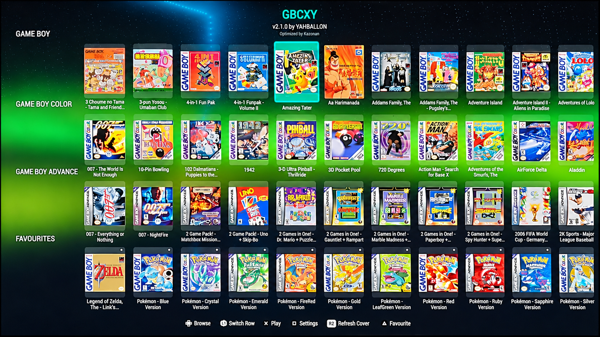
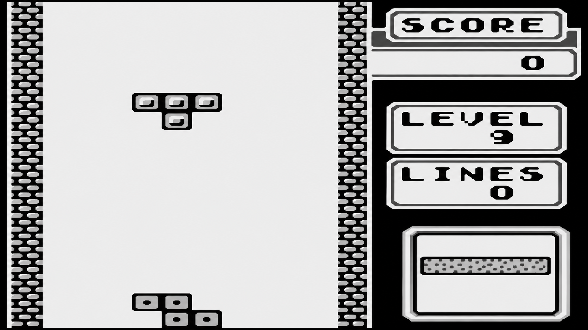

<div align="center">


# GBCXY
### 8-Bit Colors. Next-Gen CoverFlow.

**Game Boy · Game Boy Color · Game Boy Advance — on PlayStation 5**

[](https://github.com/kastroe/GBCXY-Releases/releases/latest)
[](https://github.com/kastroe/GBCXY-Releases/releases/tag/v2.1.0)
[](https://github.com/kastroe/GBCXY-Releases/releases/tag/v2.1.0)

**v2.1.0 by Kastroe · Title ID: `PPSA99210`**  
*Originally developed by YAHBALLON*

**[⬇ Download v2.1.0](https://github.com/kastroe/GBCXY-Releases/releases/tag/v2.1.0)** · **[📦 Corresponding source](https://github.com/kastroe/GBCXY-Releases/releases/download/v2.1.0/GBCXY-v2.1.0-source-380035e.zip)**

</div>

---

## ✨ A classic handheld collection, reimagined for PS5

**GBCXY** is a homebrew emulator for **Game Boy (GB), Game Boy Color (GBC), and Game Boy Advance (GBA)** on homebrew-enabled PlayStation 5 consoles. Powered by **mGBA 0.10.5**, it combines native emulation with an animated, Vulkan-based **3D CoverFlow** library, artwork caching, customizable controls, and NAS/NFS game loading.

Version **2.1.0** adds GBA support and working **Super Game Boy border-inclusive output**, alongside fixes for cartridge save compatibility. The exact released build was tested on a PS5 before publication.

> [!IMPORTANT]
> **In-place upgrade:** GBCXY keeps Title ID `PPSA99210` and existing runtime data under `/data/PS5GBC/`. Do **not** delete that folder when updating; it holds your saves, settings, game library data, and cached artwork.

## 📸 Screenshots

<div align="center">

### 3D CoverFlow game library


*Browse your collection with cartridge-style artwork, reflections, and favourites.*

### Settings and personalization


*Choose your display preferences, themes, controls, and library options.*

### Game Boy gameplay


*Classic Game Boy gameplay on PS5.*

</div>

> These are the original screenshots already hosted in this repository. Their imagery may depict an earlier build; v2.1.0 additionally supports GBA and Super Game Boy borders.

## 🚀 What's inside v2.1.0?

| Feature | What it offers |
| --- | --- |
| 🎮 **GB · GBC · GBA** | mGBA-powered support for all three handheld systems |
| 🖼️ **3D CoverFlow** | Animated glass-style cartridge cases, reflections, neon edges, and wraparound navigation |
| 🌈 **Five themes** | Chromatic Shift, Pocket Forest, Berry Soda, Polar LCD, and Retro Amber |
| ✨ **Chromatic Pocket intro** | Animated 8-bit loading presentation with a cartridge emblem and real scan counts |
| 🧩 **Super Game Boy borders** | Border-inclusive **256×224** video support for compatible games |
| 📐 **Display scaling** | Full-screen stretch, original aspect ratio, or integer scaling |
| 🌐 **NAS/NFS libraries** | Load games from configured network shares without copying the collection to PS5 storage |
| 💾 **Saves and states** | Cartridge saves, supported RTC data, save states, and resume features |
| ⭐ **Art and favourites** | Artwork lookup/cache, adjustable cover sizes, persistent favourites, and search |
| 🎛️ **Custom controls** | Global/per-game mappings, fast-forward, and save/load shortcuts |

**Video geometry:** GB/GBC `160×144` · SGB `256×224` (including borders) · GBA `240×160`.

### 🎨 Pick your theme

**Chromatic Shift** — turquoise and purple · **Pocket Forest** — retro LCD greens · **Berry Soda** — pink and sunset orange · **Polar LCD** — cool blue and white · **Retro Amber** — vintage golden tones.

Change your theme from **Settings → Appearance → Theme**. Preferences are saved in the existing configuration.

## 📥 Download and installation

**[Get GBCXY v2.1.0 on GitHub Releases](https://github.com/kastroe/GBCXY-Releases/releases/tag/v2.1.0)**

1. Download **[`GBCXY-v2.1.0-by-Kastroe-FINAL-RC.zip`](https://github.com/kastroe/GBCXY-Releases/releases/download/v2.1.0/GBCXY-v2.1.0-by-Kastroe-FINAL-RC.zip)** — this is the **installable PS5 package**, despite its build-stage filename.
2. Extract the **complete `PPSA99210` folder**, retaining `eboot.bin`, `sce_sys`, `sce_module`, and the packaged helper.
3. Copy the folder to a supported homebrew location on your PS5, commonly `/data/homebrew/PPSA99210/`, and launch GBCXY.

> [!NOTE]
> The **source-code ZIP is not an installable PS5 package**. Use the production ZIP linked above. This release does **not** contain commercial ROMs or BIOS images.

**Verified production SHA-256:**
```text
10eccb33fbf171192f9a2ed7daaa9690905b4debce86c4d429df1f86809901fd
```

The release also provides the corresponding-source archive and `SHA256SUMS.txt`.

### 📂 Game and save locations

```text
/data/PS5GBC/games/
/data/PS5GBC/roms/
/data/PS5GBC/saves/
/data/PS5GBC/states/
/data/PS5GBC/covers/
/data/PS5GBC/cache/
/data/PS5GBC/logs/
```

You can also use USB directories such as `/mnt/usb0/homebrew/PS5GBC/games/` and configured NFS libraries. Use your own legally acquired GB/GBC/GBA games.

## 🎮 Controls

### In the library

| Input | Action |
| --- | --- |
| D-pad Left / Right | Browse within the current row |
| L1 / R1 | Jump through the row |
| Up | Cycle the library collection |
| Down | Open library search |
| Triangle | Toggle favourite |
| Square | Open settings |
| R2 | Refresh selected artwork |
| Cross / Options | Launch game |
| Circle | Show exit confirmation |

### In-game

| Input | Action |
| --- | --- |
| Cross / Circle | A / B |
| D-pad | Directional input |
| Options / Create | Start / Select |
| Hold L2 | Fast-forward |
| L3 + R3 + Up | Save state |
| L3 + R3 + Down | Load state |
| Hold L1 + R1 + Touchpad (2 seconds) | Return to library |

Mappings and shortcuts can be changed globally or per game. From the library, **Circle** opens the exit confirmation; **Cross** confirms and **Circle** cancels.

## 🌐 NAS/NFS libraries and artwork

Open **Settings → Network → NFS URL** and enter a configured share, for example:

```text
nfs://your-server/export/gbcxy
```

Alternatively, put one share per line in `/data/PS5GBC/nfs.txt`. The library caches discovered games between launches and supports refresh/rescan workflows. Do not put private server addresses or credentials in public repository files.

For artwork, GBCXY prefers local covers and the persistent cache, then uses system-specific lookup:

- **Game Boy:** [Libretro GB Named_Boxarts](https://thumbnails.libretro.com/Nintendo%20-%20Game%20Boy/Named_Boxarts/)
- **Game Boy Color:** [Libretro GBC Named_Boxarts](https://thumbnails.libretro.com/Nintendo%20-%20Game%20Boy%20Color/Named_Boxarts/)
- **Game Boy Advance:** recognized and handled by the existing on-demand artwork policy

GB and GBC artwork sources remain separate to avoid mismatched covers. Missing artwork can be requested manually from **Settings → Artwork → Scrape Missing Artwork**; automatic cover downloads are off by default. Cached images are stored locally.

## 💾 Saves and backwards compatibility

Battery saves and supported RTC data live under `/data/PS5GBC/saves/`; save states live under `/data/PS5GBC/states/`. Save-state shortcuts and resume features remain available. Existing data is retained through an in-place upgrade.

**v2.1.0 fixes** include valid Super Game Boy `256×224` output being rejected at launch and compatibility with an existing **64 KiB Mario Kart: Super Circuit** cartridge save. The final production candidate passed host tests and user PS5 hardware testing.

## 🛠️ Source code and building

The **[v2.1.0 release](https://github.com/kastroe/GBCXY-Releases/releases/tag/v2.1.0)** includes a **[corresponding-source archive](https://github.com/kastroe/GBCXY-Releases/releases/download/v2.1.0/GBCXY-v2.1.0-source-380035e.zip)** at source commit:

```text
380035e314bd7e30f793883a24b23e1b5db996f2
```

**Source tree overview:**

```text
gbc/src/                 Core wrapper, emulator and startup animation
gbc/third_party/mgba/    Vendored mGBA sources
gbc/tools/               PS5 build scripts and regression tests
ps5/frontend/            Library, artwork, settings and Vulkan integration
ps5/porpoise_original/   Porpoise-derived frontend sources
ps5/frontend/assets/     UI assets
tests/                   Host-side checks
.github/workflows/       Build automation definitions
```

Build documentation (`BUILDING.md`, `INSTALL.md`, `CONTROLS.md`, and `TESTING.md`) is available **inside the corresponding-source archive**.

Builds require a Linux environment such as WSL, the relevant PS5 payload toolchain/SDK, Clang/LLVM 18, CMake/Ninja, Vulkan dependencies, libnfs, and prepared PacBrew libraries. A host-only test build is **not** an installable PS5 package. Refer to the archive's instructions for pinned dependencies and build commands.

## ❤️ Credits and licences

**GBCXY v2.1.0 by Kastroe · Originally developed by YAHBALLON.**

Emulation is powered by **[mGBA](https://github.com/mgba-emu/mgba)** (MPL-2.0). Frontend development incorporates **[Porpoise](https://github.com/elripalda/Porpoise-Dolphin-Emulator-for-PS5)** and other attributed open-source PS5 work. Additional components include libnfs, Vulkan-related tooling, font libraries, stb libraries, and other upstream dependencies under their respective licences.

Project portions are distributed under **GPL-3.0-or-later** where applicable. The corresponding-source archive contains `LICENSE`, `COPYING.GPLv3`, `THIRD_PARTY_NOTICES.md`, `gbc/licenses/`, and other bundled notices. See those files before redistribution. Project-specific artwork and logos retain their stated permissions.

GBCXY is an independent community homebrew project and is **not affiliated with Sony or Nintendo**. No commercial ROMs, copyrighted BIOS images, or pirated games are distributed.

---

<div align="center">

### Ready to revisit your handheld favourites?

**[⬇ Download GBCXY v2.1.0](https://github.com/kastroe/GBCXY-Releases/releases/tag/v2.1.0)**

*Made for the PS5 homebrew community · Developed by Kastroe · Original project by YAHBALLON*

</div>
