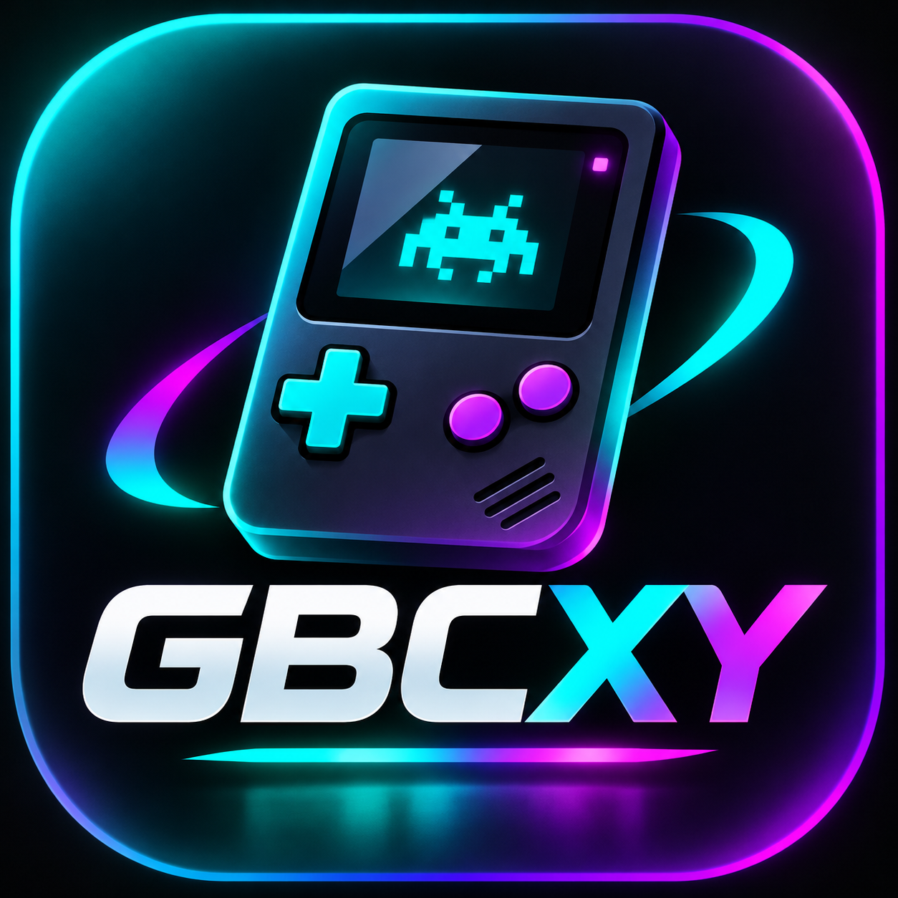
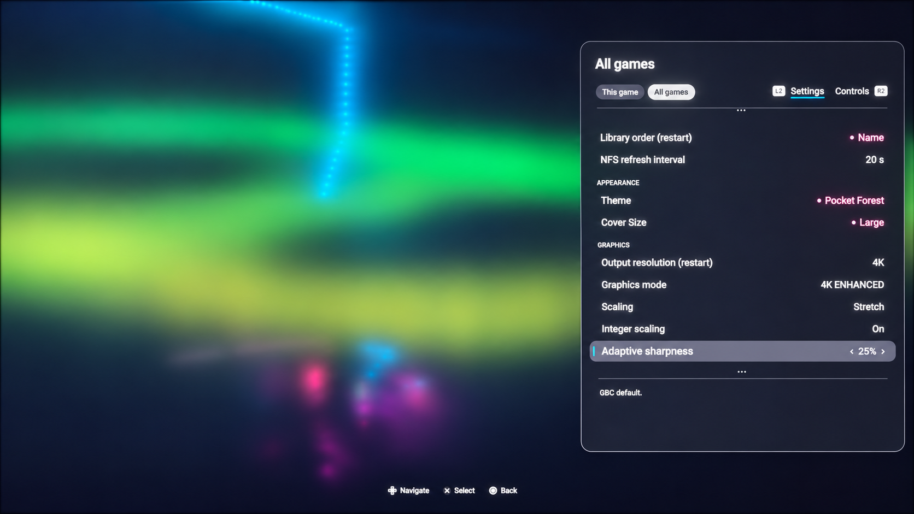

<div align="center">



# GBCXY

### 8-Bit Colours. Next-Gen CoverFlow.

**Game Boy · Game Boy Color · Game Boy Advance · PlayStation 5**

[](https://github.com/kastroe/GBCXY-Releases/releases/latest)


**Version 2.1.1 by Kastroe** · *Originally developed by YAHBALLON*

Turn your handheld collection into a cartridge-style library on your homebrew-enabled PS5. Native emulation, animated **3D CoverFlow**, cover artwork, save states, themes, and local or NAS-hosted ROMs.

### [⬇ Download GBCXY v2.1.1](https://github.com/kastroe/GBCXY-Releases/releases/download/v2.1.1/GBCXY-v2.1.1.zip) · [📋 Release notes](https://github.com/kastroe/GBCXY-Releases/releases/tag/v2.1.1) · [💬 Get support](https://github.com/kastroe/GBCXY-Releases/discussions)

</div>

---

## 📸 Screenshots

<div align="center">

### The CoverFlow library


*Browse your collection with animated cartridge artwork and favourites.*

<table>
<tr>
<td align="center" width="50%">
<br>
<b>Settings & customisation</b>
</td>
<td align="center" width="50%">
<br>
<b>Game Boy gameplay</b>
</td>
</tr>
</table>

<sub>Screenshots are from earlier builds and may differ slightly from the latest interface.</sub>

</div>

---

## ⚡ Quick start

1. **[Download v2.1.1](https://github.com/kastroe/GBCXY-Releases/releases/download/v2.1.1/GBCXY-v2.1.1.zip)** and extract the ZIP.
2. Copy the full `PPSA99210` directory to `/data/homebrew/PPSA99210/` on your PS5.
3. Put your legally obtained `.gb`, `.gbc`, `.gba` or supported `.zip` files in `/data/PS5GBC/games/`.
4. Launch GBCXY and let the library scan finish. Configure additional folders under **Settings → Game directories**.

> [!IMPORTANT]
> **Upgrading? Keep `/data/PS5GBC/` intact.** It holds games, saves, states, artwork, settings and caches. Do not delete it when replacing the application.

**Jump to:** [Install](#-1-installing-gbcxy-on-ps5) · [Add games](#-2-adding-games-to-your-ps5) · [NAS/NFS](#-3-connecting-gbcxy-to-a-nas-using-nfs) · [USB](#-4-loading-games-from-usb) · [Troubleshooting](#️-5-troubleshooting--games-not-appearing) · [Controls](#-6-dualsense-controls) · [Themes](#-7-themes-and-artwork) · [Data folders](#-8-save-data-and-folder-reference)

---

## ✨ Highlights

| | |
|---|---|
| 🎮 **Three handheld systems** | GB, GBC and GBA powered by mGBA 0.10.5 |
| 🖼️ **3D CoverFlow** | Animated cartridge-style browsing and artwork caching |
| 🌐 **NAS / NFS** | Browse ROMs on supported network storage |
| 📂 **Local / USB folders** | Scan ROMs from PS5 storage and supported USB locations |
| 💾 **Saves & states** | Battery saves, RTC support and quick save states |
| ⭐ **Favourites** | Organise your go-to games |
| 🎨 **Five themes** | Chromatic Shift, Pocket Forest, Berry Soda, Polar LCD, Retro Amber |
| 🧩 **Super Game Boy** | Enhanced 256×224 borders |
| 🎛️ **DualSense controls** | Remappable buttons and fast-forward |
| 🔍 **Artwork scraper** | System-aware matching with local cache |

---

# 📥 1. Installing GBCXY on PS5

### Step 1 — Download the application

Download the official release package:

**[GBCXY-v2.1.1.zip](https://github.com/kastroe/GBCXY-Releases/releases/download/v2.1.1/GBCXY-v2.1.1.zip)**

This is the installable homebrew package.

Do not download the corresponding-source ZIP for installation.

### Step 2 — Extract the ZIP

Extract the complete ZIP on your computer.

You should have a folder named:

`PPSA99210`

Inside that folder are the PS5 executable and its required files, including:

```text
PPSA99210/
├── eboot.bin
├── sce_sys/
├── sce_module/
└── Other packaged files
```

Keep the entire directory structure intact.

### Step 3 — Transfer to your PS5

Using PS5Upload, PS5 Web File Manager or another compatible file-transfer utility, transfer the complete `PPSA99210` folder to:

```text
/data/homebrew/PPSA99210/
```

The executable should be located at:

```text
/data/homebrew/PPSA99210/eboot.bin
```

If your homebrew launcher uses another supported directory, follow that launcher's requirements.

### Step 4 — Launch GBCXY

Launch GBCXY through your compatible PS5 homebrew environment.

The program should initialise its settings and game library.

**Upgrading from an earlier version?**

Keep the existing directory:

`/data/PS5GBC/`

Do not delete it. This directory contains your settings, ROMs, save data, artwork and library cache.

---

# 📂 2. Adding Games to Your PS5

**If you're not using a NAS, this is the easiest way to set up GBCXY.**

### Step 1 — Open your PS5 file manager

Connect to your console using PS5Upload or PS5 Web File Manager.

Navigate to:

```text
/data/PS5GBC/
```

### Step 2 — Locate the correct ROM folder

Your primary game directory is:

```text
/data/PS5GBC/games/
```

If the folder does not exist, create a folder named:

`games`

inside `/data/PS5GBC/`.

**Important:** Do not confuse `/data/PS5GBC/games/` with the application installation directory `/data/homebrew/PPSA99210/`.

The application and ROM directories serve different purposes.

### Step 3 — Upload your ROMs

Place your legally obtained Game Boy, Game Boy Color and Game Boy Advance ROM files inside the `games` folder.

Example:

```text
/data/
└── PS5GBC/
    └── games/
        ├── Tetris.gb
        ├── Pokemon Red.gb
        ├── Pokemon Crystal.gbc
        ├── Zelda Oracle of Ages.gbc
        ├── Metroid Fusion.gba
        └── Mario Kart Super Circuit.gba
```

Supported formats:

| System | Extension |
|---|---|
| Game Boy | `.gb` |
| Game Boy Color | `.gbc` |
| Game Boy Advance | `.gba` |
| Supported compressed ROMs | `.zip` |

For your first test, place one or two uncompressed ROMs directly inside the games folder rather than in subfolders.

### Step 4 — Start GBCXY

Launch GBCXY and let the library scan complete.

Your games should appear in their respective Game Boy, Game Boy Color and Game Boy Advance collections.

If you add more games later, refresh the library using the supported refresh option or restart GBCXY.

**You do not need to configure NFS if your ROMs are stored directly on your PS5.**

---

# 🌐 3. Connecting GBCXY to a NAS Using NFS

GBCXY can access ROMs stored on a NAS over your home network.

This allows you to keep your collection on network storage instead of copying everything onto the PS5.

Supported NFS-capable devices may include Asustor, Synology, QNAP and Linux-based NAS systems.

**Important: GBCXY uses NFS for this connection method, not ordinary Windows SMB sharing.**

## Step 1 — Create a ROM folder on your NAS

Open your NAS administration interface.

Create a shared folder for your ROM collection, for example:

`Roms`

You can organise your games like this:

```text
Roms/
├── GameBoy/
│   ├── Tetris.gb
│   └── Pokemon Red.gb
├── GameBoyColor/
│   ├── Pokemon Crystal.gbc
│   └── Zelda Oracle of Ages.gbc
└── GameBoyAdvance/
    ├── Metroid Fusion.gba
    └── Mario Kart Super Circuit.gba
```

Alternatively, use separate NFS shares for each system.

The shared folder must contain readable ROM files.

## Step 2 — Enable NFS on the NAS

In your NAS administration interface, locate the NFS service.

Depending on the manufacturer, it may be listed under:

**Services → NFS**

or

**File Services → NFS**

Enable NFS.

On some NAS systems, you must also enable NFS permissions individually for the shared folder.

## Step 3 — Allow your PS5 to access the share

Find the NFS permission settings for your ROM folder.

Add your PS5's IP address as an authorised client.

Example:

```text
NAS IP: 192.168.1.100
PS5 IP: 192.168.1.101
```

These are examples. Use your own network addresses.

For a ROM library, read-only access is normally enough.

Ensure:

- Your PS5 and NAS are on networks that can communicate.
- NFS is enabled.
- Your ROM share is exported.
- Your PS5 is authorised to access that export.
- The directory and files have appropriate read permissions.
- Your NAS firewall allows the required NFS traffic.

Avoid granting unrestricted access to your entire network when a specific PS5 address will work.

## Step 4 — Find the actual NFS export path

This step is important.

Your NAS may show a friendly shared-folder name such as:

```text
Roms
```

However, its actual NFS export path may be different.

Examples:

| NAS type | Example export path |
|---|---|
| Asustor | `/volume2/Roms` |
| Synology | `/volume1/Roms` |
| Linux | `/srv/roms` |

These are examples, not universal paths.

**Use the actual export path configured on your NAS.**

Do not assume the export path is the same as the folder name shown in Windows File Explorer.

## Step 5 — Find your NAS IP address

Look in your NAS network settings or router's connected-device list.

For example:

`192.168.1.100`

For reliable connections, consider reserving the NAS's IP address in your router.

## Step 6 — Enter the NFS address in GBCXY

Open GBCXY on your PS5.

Navigate to:

**Settings → Network → NFS URL**

Enter the NFS address using this format:

```text
nfs://NAS-IP/EXPORT-PATH
```

For example, if your NAS IP is `192.168.1.100` and the exported directory is `/volume2/Roms`, enter:

```text
nfs://192.168.1.100/volume2/Roms
```

Use your actual NAS address and export path.

Save the setting.

**Restart GBCXY after changing your NFS configuration**, as changes to configured shares may require an application restart.

## Step 7 — Using multiple NFS shares

GBCXY also supports configuring network shares through:

```text
/data/PS5GBC/nfs.txt
```

Open or create this text file through your PS5 file manager.

Enter one NFS share per line:

```text
nfs://192.168.1.100/volume2/GameBoy
nfs://192.168.1.100/volume2/GameBoyColor
nfs://192.168.1.100/volume2/GameBoyAdvance
```

Replace these examples with your own export addresses.

Save the file and restart GBCXY.

Do not add Windows-style network paths such as `\\NAS\Roms` to this file.

## Step 8 — Check your NAS library

After restarting, allow GBCXY to connect and scan its configured sources.

Your NAS-hosted games should appear in the game library if the exports are accessible and contain supported ROMs.

If a connection fails, verify the NAS IP, NFS export path, client permissions and network connectivity before changing any ROM files.

---

# 💽 4. Loading Games From USB

GBCXY v2.1.1 supports predefined USB scanning locations and configurable additional game directories.

One example is:

```text
/mnt/usb0/homebrew/PS5GBC/games/
```

To use this layout:

1. Connect a compatible USB storage device to your PS5.
2. Use a supported file manager to verify its mount location.
3. Create the required `homebrew/PS5GBC/games` folders under that mount.
4. Place your GB, GBC or GBA ROMs inside the games folder.
5. Launch or refresh GBCXY to scan the supported USB location.

USB mount paths vary by device and homebrew environment, so check the actual mounted path.

**Note:** In v2.1.1, additional local game folders can be configured in **Settings → Game directories**. Verify that the folder exists, that it contains supported ROMs, and that recursive scanning is enabled when using subfolders.

---

# 🛠️ 5. Troubleshooting & Reporting Problems

> [!IMPORTANT]
> **Check your installation before assuming the emulator is broken.** ROMs not appearing can be caused by incorrect transfer paths, missing files, game-directory settings, a scan that hasn't finished, NAS permissions, or a filtering option. **Do not delete `/data/PS5GBC/`, saves, artwork or library caches while troubleshooting.**

## A. GBCXY does not launch / crashes on startup

1. Confirm you downloaded the **v2.1.1 PS5 application ZIP**, not a source-code archive.
2. **Extract the ZIP** and transfer the **complete** `PPSA99210` folder, preserving its subfolders.
3. Check that the executable actually exists at `/data/homebrew/PPSA99210/eboot.bin`; it should not be nested inside a second `PPSA99210` directory.
4. Confirm you're launching it using a homebrew environment compatible with your PS5 setup.
5. If upgrading, preserve `/data/PS5GBC/` and note whether the previous version still launched.
6. If it still fails, capture the exact on-screen message or behaviour, when it happens, and any available logs.

## B. Local ROMs are missing (including ROM hacks)

**Default ROM folder:** `/data/PS5GBC/games/`  
**Application install folder (not your ROM folder):** `/data/homebrew/PPSA99210/`

1. **Confirm the files actually exist on the PS5.** Open PS5Upload or PS5 Web File Manager and inspect the full path. Seeing files on your PC is not proof they were uploaded to the console.
2. **Check the extensions.** Supported ROM extensions include `.gb`, `.gbc`, `.gba` and supported `.zip` archives. For diagnosis, use one known-working, uncompressed ROM of your own directly under `/data/PS5GBC/games/`.
3. **Open Settings → Game directories.** Verify that the primary local folder and any custom folders match the actual PS5 paths **character for character**. A directory name alone isn't enough: it must be the real full path.
4. **Check recursive scanning.** If your games are in subfolders, enable the recursive option for that directory.
5. **Refresh the library** and give the scan time to complete. For a large NAS collection, the initial scan may take longer.
6. **Clear search and check filters/collections.** A game may be present but hidden from the currently selected view.
7. **Try a second small test folder** if needed, containing just one uncompressed ROM. Add the exact folder path under Game directories and refresh.
8. If the test ROM works but the other files do not, report examples of **filenames and extensions** (not ROM contents), whether files are zipped, and whether this affects GB, GBC or GBA.

**For custom folders:** share screenshots of both the PS5 file manager showing the actual directory and the GBCXY **Game directories** screen. These two screenshots often reveal a path mismatch immediately.

**For ROM hacks:** the fact that a file is a Pokémon hack does not automatically explain a missing library entry. First determine whether GBCXY can enumerate that directory and whether ordinary ROMs alongside it appear.

## C. NAS / NFS games are missing or scanning is slow

1. Confirm the **NAS is online** and reachable on your network.
2. Check that **NFS is enabled**, the ROM directory is **exported**, and your PS5 is permitted to access that export.
3. Use your NAS's **actual export path**, not just its friendly shared-folder name.
4. Recheck your configured `nfs://` address or entries in `/data/PS5GBC/nfs.txt`. Ordinary Windows `\\NAS\Share` paths are **not** NFS URLs.
5. Confirm that the export allows reading files and traversing directories, including subfolders.
6. Restart GBCXY after changing NFS configuration, then allow the initial scan to finish before judging performance.
7. If the initial scan is unusually slow, record the **number of games, approximate scan duration, NAS model, whether ROMs are compressed, and whether the slowdown happens on every cold start or only the first one**.
8. Do **not** clear the NAS library cache just to test an NFS problem. A repeat full scan can make diagnosis harder.

**Privacy:** when reporting NFS configuration, you may redact private IP addresses and share names. Keep the URL structure visible so the setup can still be assessed.

## D. Games appear, but covers, favourites or saves are wrong

- **Covers missing or incorrect:** check the filename, artwork settings and whether a scrape has completed. Report the title and system (GB/GBC/GBA); include a screenshot of the incorrect or missing cover.
- **Favourites or search appear wrong:** clear any active search/filter, restart once and note if the issue persists. Include a screenshot of the selected row or collection.
- **Save data or save states missing:** stop before deleting anything. Check whether you're still using the same `/data/PS5GBC/` data folder and provide the game name, save type (battery save or save state) and what happened before it went missing.
- **Freezes or crashes while launching a game:** record the game/system, whether it is a compressed ROM or hack, the exact step that fails, and whether another known-working ROM launches.

## E. 🚨 IMPORTANT — Capture a fresh boot.log

> [!IMPORTANT]
> **READ THIS BEFORE REPORTING MISSING GAMES OR STARTUP PROBLEMS.** Kastroe needs a **fresh boot.log from the initial library scan**, not an old log full of repeated refreshes.
>
> **DO NOT DELETE `/data/PS5GBC/` — EVER FOR TROUBLESHOOTING.** It contains your ROMs, saves, save states, settings, artwork and library caches.

### Follow these steps in order

1. **Close GBCXY completely.**
2. Using PS5Upload or PS5 Web File Manager, **delete only the installed GBCXY application folder**, normally `/data/homebrew/PPSA99210/`. Verify the install location first if your launcher uses a different directory.
3. **Reinstall the latest GBCXY release:** extract the ZIP and copy the complete `PPSA99210` folder to the PS5 application location.
4. **Launch GBCXY and wait for the library to finish loading, if it does.** If the library never loads, the app freezes, or it crashes, note when and how it failed.
5. **After that attempt**, download the actual log file from `/data/PS5GBC/logs/boot.log` to your computer.
6. **Send the boot.log to Kastroe** through [GitHub Discussions](https://github.com/kastroe/GBCXY-Releases/discussions), along with your GBCXY version, installation method, exact game-folder paths, screenshot of **Settings → Game directories**, and what happened.

If `boot.log` is missing, empty or not from this launch, state its file size and modification time. If reinstalling isn't practical, a log from a normal fresh start is still helpful—just say it wasn't reinstalled. Other files under `/data/PS5GBC/logs/`, such as `settings.log`, may also help.

> [!WARNING]
> **DO NOT delete `/data/PS5GBC/`, your ROMs, save files, artwork or library cache to capture a log.** Redact passwords, credentials and private information before sharing.

## F. Exactly what to send when requesting help

Copy this template into a new post in **[GBCXY GitHub Discussions](https://github.com/kastroe/GBCXY-Releases/discussions)**, together with the relevant screenshots and log files.

```text
GBCXY BUG / SUPPORT REPORT

1. GBCXY version:
   (Example: v2.1.1; include ZIP filename if known)

2. PS5 environment:
   (Firmware and homebrew/loader setup, if comfortable sharing)

3. Installation method:
   (Tool used to transfer/install GBCXY)
   Application folder on PS5:

4. Problem:
   (What exactly happens? What did you expect instead?)

5. When it happens:
   (Startup / folder scan / refresh / launching a game / saving / other)

6. ROM location(s):
   (Exact local folders or redacted NFS URL/export structure)
   File extensions involved:
   Number of ROMs expected:
   Number actually visible:
   Recursive scanning on/off:

7. What you've already tried:
   (List steps and results; don't just say "nothing works")

8. Evidence attached:
   [ ] Screenshot: GBCXY Game directories settings
   [ ] Screenshot: PS5 file manager showing real ROM paths
   [ ] Screenshot/video: error or unexpected behaviour
   [ ] Log files from /data/PS5GBC/logs/
   [ ] Scan duration / counts, if scan-related

9. Other details:
   (Was this working in an earlier version? Is the issue repeatable?)
```

> [!TIP]
> **Best evidence for missing games:** one screenshot showing where the ROM files really are, one showing GBCXY's configured game folders, plus the latest available scanner/boot logs. That lets the developer compare the installation and the configuration before changing the code.

**Do not post ROM files, BIOS files, copyrighted game data, or credentials.** If logs contain sensitive details, redact those before sharing.

---

# 🎮 6. DualSense Controls

### Library controls

| Input | Action |
|---|---|
| D-pad Left / Right | Browse within the current row |
| L1 / R1 | Jump through the row |
| Up | Cycle the library collection |
| Down | Open library search |
| Triangle | Toggle favourite |
| Square | Open settings |
| R2 | Refresh selected artwork |
| Cross / Options | Launch game |
| Circle | Show exit confirmation |

### In-game controls

| Input | Action |
|---|---|
| Cross / Circle | A / B |
| D-pad | Directional input |
| Options / Create | Start / Select |
| Hold L2 | Fast-forward |
| L3 + R3 + Up | Save state |
| L3 + R3 + Down | Load state |
| Hold L1 + R1 + Touchpad (2 seconds) | Return to library |

Controls and shortcuts can be customised globally or per game.

---

# 🎨 7. Themes and Artwork

GBCXY offers five visual themes:

- Chromatic Shift
- Pocket Forest
- Berry Soda
- Polar LCD
- Retro Amber

Change your theme from:

**Settings → Appearance → Theme**

GBCXY supports system-specific cover artwork matching.

Game Boy and Game Boy Color covers use separate artwork sources to reduce mismatched covers.

To request missing artwork, open:

**Settings → Artwork → Scrape Missing Artwork**

Automatic cover downloads are disabled by default.

Downloaded artwork is cached locally.

---

# 💾 8. Save Data and Folder Reference

GBCXY keeps its user data under:

```text
/data/PS5GBC/
```

| Folder | Purpose |
|---|---|
| `/data/PS5GBC/games/` | Primary ROM directory |
| `/data/PS5GBC/roms/` | Additional built-in ROM location |
| `/data/PS5GBC/saves/` | Battery saves and RTC data |
| `/data/PS5GBC/states/` | Save states |
| `/data/PS5GBC/covers/` | Local cover artwork |
| `/data/PS5GBC/cache/` | Library and other cached data |
| `/data/PS5GBC/logs/` | Diagnostic logs |
| `/data/PS5GBC/nfs.txt` | Optional NFS share configuration |

**Do not delete `/data/PS5GBC/` when upgrading GBCXY.**

Keep backups of important save and state files before changing installations.

---

# 📦 9. Release information

| | |
|---|---|
| **Latest release** | **GBCXY v2.1.1 by Kastroe** |
| **PS5 title ID** | `PPSA99210` |
| **Installer ZIP** | [GBCXY-v2.1.1.zip](https://github.com/kastroe/GBCXY-Releases/releases/download/v2.1.1/GBCXY-v2.1.1.zip) |
| **ZIP SHA-256** | `22a6d8c9ef824d1abd29248586fc134b83209cc7d6a3cb659f980086cba2ec46` |
| **Release page** | [v2.1.1](https://github.com/kastroe/GBCXY-Releases/releases/tag/v2.1.1) |

Version 2.1.1 improves local game-directory detection and library caching. It was tested on PS5 hardware with local Pokémon ROM hacks and an NFS-hosted library.

**Previous version:** [v2.1.0](https://github.com/kastroe/GBCXY-Releases/releases/tag/v2.1.0) includes a corresponding-source archive and earlier checksums. Do not use those earlier hashes to validate the v2.1.1 package.

---

# 🛠️ 10. Source Code and Building

The corresponding-source archive contains the GBCXY source and relevant project documentation.

The source tree includes:

```text
gbc/src/
gbc/third_party/mgba/
gbc/tools/
ps5/frontend/
ps5/porpoise_original/
ps5/frontend/assets/
tests/
.github/workflows/
```

PS5 native builds require a supported development environment with the appropriate PS5 SDK, Clang/LLVM, CMake/Ninja, Vulkan dependencies, libnfs and prepared third-party libraries.

See the corresponding-source archive's `BUILDING.md`, `INSTALL.md`, `CONTROLS.md` and `TESTING.md` for development details.

A host-only test executable is not an installable PS5 application.

---

# ❤️ Credits and Licences

**Kastroe** — Current development, modifications, optimisation and release maintenance.

**YAHBALLON** — Original GBCXY developer.

**mGBA contributors** — Game Boy, Game Boy Color and Game Boy Advance emulation.

**Porpoise contributors** — Frontend components and related upstream work.

Additional credits apply to libnfs, Vulkan-related components, font libraries, stb libraries and other bundled dependencies.

The corresponding-source archive includes applicable GPL, MPL, MIT and other third-party licence notices.

GBCXY is an independent community PS5 homebrew project. It is not affiliated with Sony or Nintendo.

**No commercial ROMs or BIOS files are distributed.**

---

<div align="center">

### 🎮 Your handheld collection, on PS5.

**[⬇ Download v2.1.1](https://github.com/kastroe/GBCXY-Releases/releases/download/v2.1.1/GBCXY-v2.1.1.zip)** · **[💬 Support & testing](https://github.com/kastroe/GBCXY-Releases/discussions)**

*Developed by Kastroe · Originally created by YAHBALLON*

</div>
